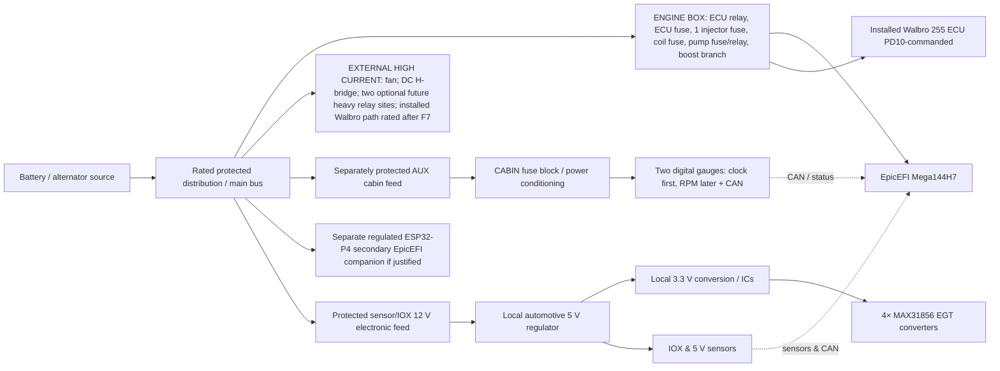

# Expansion-capable electrical power-distribution concept — slot, rail and source budget

**v0.3, 2026-11-02 · latest user corrections: installed Walbro 255; one Pierburg reuses former PWM Idle circuit; TWO gauges only, NO Pi/extra displays; ESP32-P4 companion; optional two external high-current relay spaces. Refer to [authoritative correction record](AS_BUILT_CORRECTIONS_AND_RELAY_OPTIONS_2026_11_02.md). **No fuse or relay ratings approved.**

## Design goals inherited from user

- Replace **aged aftermarket MegaSquirt power/relay board** powering Mega144H7/EpicEFI; leave old factory Volvo LH circuits outside scope.
- User has **four EV14 injectors currently powered in two pairs through two old-box fuses**; draft replacement has **ONE injector +12 V fuse** and four separate ECU sequential low-side drivers.
- No PWM idle valve/Fast Idle actuator is used, BUT **one of the two Pierburg boost solenoids reuses the former PWM Idle circuit**. Actual K3/JP1/CB3 involvement must be traced; separately relayed DC idle H-bridge stays external.
- Plan capacity for IOX/EGT/EMAP/sensors, an ESP32-P4 secondary controller and **only two** digital gauges/CAN; **exclude Pi/CarPi/other new ESP32 displays and head-unit conversion**.
- Study standard **Micro ISO/Micro 280 plug-in** automotive relays and accessible blade fuses for engine box; also **two optional external Maxi ISO/high-current relays** only for future electromechanical conversions, not engine-box R1–R4.
- Current upstream X1 feed has **30 A near-battery fuse** and **~4 mm² cable user estimate** (not actually conductor-measured). **Do not assume that feed can safely power the future expansion or raise the main fuse.**

## Separation into power zones

**Diagram caveat:** Sources and arrows are **functional**, not evidence of installed physical connections or finalized regulator topology. CAN high/low data wiring **does not provide power**. Power returns must follow separate reviewed signal/power ground rules.

### Why a cabin subdistribution is preferable

The engine box should not collect long unprotected runs for the TWO planned gauges or P4 companion. A **protected small cabin auxiliary feeder with local regulation**, if needed, remains preferable. No Pi shutdown-timer, four-display or head-unit conversion demand remains; cabin feeder and physical fuse-count savings should now be reassessed.

Likewise, sensor reference power should generally be **generated locally by ECU or IOX**, with proper analog filtering/input protection. Do not design an engine power box that tries to deliver regulated sensor 5 V across the whole vehicle or uses one output fuse per thermistor/Hall sensor.

## Preliminary new engine-box relay positions (R1–R4 MICRO ISO review; TWO optional larger relays are separate EXTERNAL possibilities, not counted here)

| Cavity | Intended role | Initial populated? | Notes |
|---|---|---|---|
| **R1** | **Main ignition/run ECU engine-power relay** | YES in baseline | ON in RUN+CRANK. Keep ECU own fused branch. Exact injector/coil/solenoid switching topology reviewed in F7 |
| **R2** | **Fuel-pump relay** (ECU PD10 command) | YES in baseline | Preserve shutdown and appropriate prime; current/timing/contact polarity not assumed |
| **R3** | **Optional auxiliary/ignition relay** | Not decided | Candidate for cabin/IOX electronics switched bus if ignition-switch sense cannot directly power low-current branches; not a fast-idle relay |
| **R4** | Standard small spare | NO | Do not use as assumed high-current motor relay. Optional two Maxi ISO/high-current motor relay sites are **outside** this box and not yet populated |

**Relay footprint convention:** Investigate Omron G8HN, TE Micro ISO, HELLA Micro 280; coil polarity/suppression/PD10 interface and hot motor-current ratings must be verified. Two possible separate external Maxi ISO relay sites are future **mechanical allowances only**. Nonpopulated sockets not powered.

## Preliminary blade-fuse positions (OLD 12–14 CAVITIES TO RECOUNT after reduced scope)

**These are physical planning positions, NOT selected fuse ratings or a justified count. The older 12–14 estimate assumed four displays and Raspberry Pi. Recalculate for only two gauges and ESP32-P4, retaining necessary engine, IOX and safe spare groups. Positions F10–F14 are labels for options, not required or active circuits.

| Position | Functional load | Now / future | Switching | Supply group |
|---|---|---|---|---|
| **F01** | ECU electronics +12 V | Required now | Main R1 | ENGINE-CRITICAL |
| **F02** | **All four EV14 injector positives (single shared fuse)** | Required now | Main engine-run feed; actual timing decision TBD | ENGINE-CRITICAL |
| **F03** | VAG wasted-spark ignition-coil positive | Include if present box-owned or deliberately consolidated | Engine-run | ENGINE-CRITICAL |
| **F04** | Installed Walbro 255 L/h pump positive | Required NOW, current model unknown | ECU PD10 R2 | MOTOR-SAFETY |
| **F05** | Two Pierburg boost solenoids; **one reuses old PWM Idle circuit** | Present, feed ownership TBD, preserve reused channel | Actuator RUN, separate ECU PWM controls | ENGINE-ACTUATOR |
| **F06** | LC-1 wideband and heater supply | Conditional present ownership; separate noisy heater from sensors | Ignition run | ENGINE-ACCESSORY |
| **F07** | IOX + EGT + optional auxiliary-sensor voltage-converter input | Future expansion, first sensor auxiliary branch | Ignition run/defined start | SENSOR-ELECTRONICS |
| **F08** | Protected TWO-gauge and CAN cabin feeder | Future clock then RPM digital gauges | Accessory/ignition R3 if selected | CABIN-AUX |
| **F09** | ESP32-P4 secondary companion supply if independent feeder justified | Future, model and voltage TBD; **NOT Pi** | Defined 12 V to local regulation | ENGINE/CABIN-AUX |
| **F10** | Future low-current sensor/controller electronics or driver controls | Spare | As selected | ENGINE-AUX |
| **F11** | Future accessory actuator coil/small solenoid/aux controller | Spare | As selected | ENGINE-AUX |
| **F12** | General protected spare or external relay-control feeder | Spare | As selected | CONTROL/EXTERNAL |
| **F13 (option)** | General optional fused branch | No extra display commitment | As selected | SPARE |
| **F14 (option)** | Second general spare, diagnostic/logging or additional ECU auxiliary output | **Optional** expansion footprint | As selected | SPARE |

**Avoid combining three different things:** engine-box fuse cavities, harness outputs and any smaller downstream cabin fuse block. The two-gauge feeder should avoid redundant fuse hierarchies; P4 may require only a separate local converter. Do not preserve F08/F09 circuits solely because obsolete four-screen/Pi designs had them.

**Current bare minimum:** ECU, injector proposal, installed Walbro pump, plus independently protected ignition/boost/wideband as F6 establishes. Recount the engine fuse sockets before selecting box size; four standard Micro ISO cavities R1–R4 are an optional packaging study (R1/R2 baseline), and **two optional external Maxi ISO relays** are a different later system.

## Expansion allocation by phase

| Phase | Power-demand increment | Minimum reserved distribution capability | Decision before activation |
|---|---|---|---|
| **Now — core vehicle** | ECU, EV14, spark, pump, dual boost, existing LC-1 and fan; separate H-bridge | Keep ECU, injector, pump isolation, defined ignition feed, real fuses | Inventory physical old-box connections and actual current |
| **Near term — better engine instrumentation** | 4 thermocouples + IOX, oil pressure/temp, EMAP, fuel-pressure swap | **One protected 12 V low-current IOX electronics feed** + 5 V/3.3 V local regulators; extra ADC/DIN/FREQ/CAN channels | IOX choice, EGT/MAX31856 SPI compatible, EMAP sensor output and reference |
| **Fuel upgrades / tuning** | **Walbro 255 already installed**; flex sensor remains optional | Validate current existing pump feeder/relay and possible sensor feed | Actual Walbro part/inrush/stall/steady at pressure, sensor model |
| **Pedal/chassis inputs** | Clutch, accelerator, brake, 4 wheel speeds, steering/handbrake/reverse, accelerometer | **Regulated sensor + IOX input capacity**, not one power fuse per sensor | OEM pedal sensor supply/dual-track and electrical isolation/conditioning |
| **940-DDS cockpit** | TWO digital gauges only (clock first; RPM later) and CAN nodes as needed | Small protected cabin 12 V feeder, local regulated 5/3.3 V; no head-unit conversion | Chosen two display boards/brightness and CAN nodes |
| **Secondary EpicEFI ESP32-P4 controller** | ESP32-P4 for connections, offloading, other secondary features; **no Pi** | One regulated low-current protected feed if justified, separate from ECU/pump safety | P4 selected board, regulators, power modes, interface |
| **Conditional later** | At most TWO optional external high-current relay sites for possible electromechanical conversions; other sensors/actuators as separately approved | Independently protected heavier source and returns, appropriately rated relays/contacts; not via existing ECU X1 feed | Actual conversion load, alternator/battery, control and fault review |

## How to budget regulator and source current correctly

**Do not add 5 V or 3.3 V load amps directly to 12 V fuse amps.** Convert by power:

`I_12V ≈ (Σ (Vout × Iout)) / (Vvehicle_min × efficiency)` + power converter idle current. Use **minimum running supply voltage** for worst input current and **maximum peak** for fusing, connector and regulator thermal envelope.

- **ESP32 display controllers**: Only **two selected gauge boards**, not four; their full-board supply/brightness and any CAN regulator requirements must be verified rather than multiplying bare-chip current: https://docs.espressif.com/projects/esp-hardware-design-guidelines/en/latest/esp32s3/schematic-checklist.html
- **ESP32-P4 secondary**: exact board power and 12 V input DC/DC selection TBD; old Pi 4 5 V/3 A design provision is **not an active load**. No companion dependency for ECU/pump safety.
- **EGT MAX31856**: ~1.2 mA typical active *per chip* at 3.3 V, but IOX/MCU, thermocouple interface, CAN transceiver and conversion losses dominate total module budget. https://www.analog.com/en/products/max31856.html
- **Fuel pump** and **fan**: exact models, performance operating points, inrush and motor stall current are required before electrical and thermal design, **not** guesses based on fluid-flow or motor size alone.
- **Source 30 A upstream / 4 mm² estimated conductor**: this is the observed present system, not automatically the future source capacity. The combined **coincident** load, fuse time/current curve, cable installation temperature, ground straps and voltage drop determine any new capacity.

## Proposed electrical acceptance budgeting worksheet

The following values must be populated as numbers with evidence **before** trace widths, copper layers, cable/connector ratings, relay and fuse selections:

| Protected zone / item | V input source min/max | Typical steady A | Worst sustained A | Inrush / pulse A and duration | Wire/connector/relay limit | Thermal and voltage-drop acceptance | Evidence |
|---|---|---|---|---|---|---|---|
| ECU | TBD | TBD | TBD | TBD | TBD | TBD | Physical measured |
| Combined EV14 B+ | TBD | TBD | TBD | TBD | TBD | TBD | Coil 12 Ω supplier + as-built |
| Ignition VAG coil | TBD | TBD | TBD | TBD | TBD | TBD | As-built + part specification |
| **Installed Walbro 255** | TBD | TBD | TBD | TBD | TBD | TBD | Model, fuel pressure and load measurement |
| Two boost solenoids | TBD | TBD | TBD | TBD | TBD | TBD | Valve part and wiring |
| LC-1 heater/controller | TBD | TBD | TBD | TBD | TBD | TBD | Innovate spec and installed test |
| IOX/EGT + sensors | TBD | TBD | TBD | TBD | TBD | TBD | Regulator/IOX/EGT PCB design |
| Two-gauge cabin/CAN | TBD | TBD | TBD | TBD | TBD | TBD | TWO actual gauges/brightness |
| ESP32-P4 companion | TBD | TBD | TBD | TBD | TBD | TBD | Secondary board and regulator measurements, no Pi |
| Existing H-bridge (excluded branch) | TBD | TBD | TBD | TBD | Independently protected | Source shares trunk? TBD | User's installed relay |
| Fan (external heavy path) | TBD | TBD | TBD | TBD | External power stage | TBD | Motor model and wiring |
| Main source and engine ground | TBD | Sum coincident, TBD | Sum coincident, TBD | Worst simultaneous start/relay state | Source fuse/wire/terminal rated for overall system | TBD | X1 source and expansion trunk |

**Simultaneity matters:** Walbro pump starting, battery cranking, coil charge, injector pulses, fan start on shared trunk, two-gauge wake and P4 boot may coincide. Never size upstream from average current alone; optional future heavy relay loads require a separate future source/return review.

## F8 design-review decisions to make later, in order

1. Actual present MS box branch ownership (ECU, injector B+ pair feeds, pump, coil, boost, LC-1, fan). User's **idle correction** overrides earlier PWM/IAC assumptions.
2. Whether the new module should carry heavy pump current directly on PCB copper or use a hybrid rated external output; fan remains external by default.
3. Physical **12 or 14 fuse cavities** and 4 relay cavities vs a smaller core plus **separate cabin fuse panel** based on real enclosure and cable entry.
4. Main relay outputs and fuse-before/after relay wiring; protection on every source branch; no unintended pump bypass.
5. Actual future grouped load envelope plus dedicated cabin feed capability. Never silently attach future loads to today's old 30 A supply.
6. No optional relays or fuses energized by default; unused sockets safely unconnected until explicitly designed and fused.
7. Independent KiCad and electrical review, bench current/thermal/failure testing before actual production release.

**Status:** Old **12–14 fuse** count is explicitly **reopened to recount**, four R1–R4 Micro ISO positions provisional (two required), two additional higher-current relay sites **external optional only**, not actual installed loads. F6/F7/F8 remain OPEN. No schematic, board size or rating is approved.
