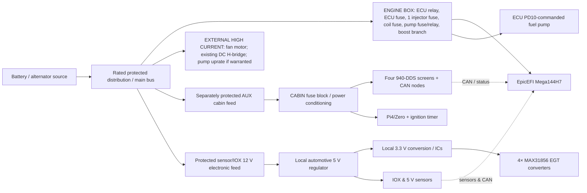

# Expansion-capable electrical power-distribution concept — slot, rail and source budget

**v0.2, 2026-11-02 · F6/F7 working planning document only · No fuse or relay ampere rating approved**

## Design goals inherited from user

- Replace **aged aftermarket MegaSquirt power/relay board** powering Mega144H7/EpicEFI; leave old factory Volvo LH circuits outside scope.
- User has **four EV14 injectors currently powered in two pairs through two old-box fuses**; draft replacement has **ONE injector +12 V fuse** and four separate ECU sequential low-side drivers.
- User uses **NO PWM idle valve or old fast-idle relay function**; has installed **independently relayed DC idle H-bridge** and reports improved operation.
- Plan capacity for **engine sensors/IOX, 4× EGT, EMAP, pressure/temperature/ethanol/pedal/wheel-speed**, and **CAN cluster/controls/logging** without routing all low-voltage sensor wires through the engine ECU power board.
- Use standard field-replaceable micro automotive relay family and individual accessible blade fuses; avoid MCU dependence and unnecessary series resistance.
- Current upstream X1 feed has **30 A near-battery fuse** and **~4 mm² cable user estimate** (not actually conductor-measured). **Do not assume that feed can safely power the future expansion or raise the main fuse.**

## Separation into power zones

**Diagram caveat:** Sources and arrows are **functional**, not evidence of installed physical connections or finalized regulator topology. CAN high/low data wiring **does not provide power**. Power returns must follow separate reviewed signal/power ground rules.

### Why a cabin subdistribution is preferable

The engine module should not accumulate four long individual wires to the gauges, Pi and all steering-wheel controls. Reserve a **protected auxiliary feeder or connector** leading to a smaller cabin fuse/regulator module. Cabin supply can be controlled by ignition, with separate protected constant-B+ for Pi shutdown timer if necessary. This keeps accessory startup/brightness/Wi-Fi transients away from ECU power and allows easy cabin expansion. No particular feeder fuse/cable size is selected.

Likewise, sensor reference power should generally be **generated locally by ECU or IOX**, with proper analog filtering/input protection. Do not design an engine power box that tries to deliver regulated sensor 5 V across the whole vehicle or uses one output fuse per thermistor/Hall sensor.

## Preliminary new engine-box relay positions (4 CAVITIES RESERVED, not finalized)

| Cavity | Intended role | Initial populated? | Notes |
|---|---|---|---|
| **R1** | **Main ignition/run ECU engine-power relay** | YES in baseline | ON in RUN+CRANK. Keep ECU own fused branch. Exact injector/coil/solenoid switching topology reviewed in F7 |
| **R2** | **Fuel-pump relay** (ECU PD10 command) | YES in baseline | Preserve shutdown and appropriate prime; current/timing/contact polarity not assumed |
| **R3** | **Optional auxiliary/ignition relay** | Not decided | Candidate for cabin/IOX electronics switched bus if ignition-switch sense cannot directly power low-current branches; not a fast-idle relay |
| **R4** | **Spare future relay / rated external load control** | NO | Unpopulated reservation and connector provisions; external motor power stage may still be preferred for fan / other heavy loads |

**Relay footprint convention:** standardized automotive *form factor* is preferred, but electrical coil current, diode polarity/TVS, contact rating and 4-pin/5-pin terminal population must be verified for chosen parts. An unpopulated spare socket cannot be live/unfused.

## Preliminary blade-fuse positions (12–14 PHYSICAL CAVITIES suggested)

**These are physical planning positions, not chosen fuse ratings.** Where an item below is not currently owned by the old MS box, it is a **future integration option**, not a mandate to rewire it now. The recommended count balances a compact engine module against concrete future sensor and cabin electronics projects.

| Position | Functional load | Now / future | Switching | Supply group |
|---|---|---|---|---|
| **F01** | ECU electronics +12 V | Required now | Main R1 | ENGINE-CRITICAL |
| **F02** | **All four EV14 injector positives (single shared fuse)** | Required now | Main engine-run feed; actual timing decision TBD | ENGINE-CRITICAL |
| **F03** | VAG wasted-spark ignition-coil positive | Include if present box-owned or deliberately consolidated | Engine-run | ENGINE-CRITICAL |
| **F04** | Fuel-pump positive | Required now; uprate later with selected 255 L/h model | ECU PD10 R2 | MOTOR-SAFETY |
| **F05** | Two boost solenoid power supplies | Conditional present ownership, recommended simple shared actuator branch | Ignition run/actuator enable | ENGINE-ACTUATOR |
| **F06** | LC-1 wideband and heater supply | Conditional present ownership; separate noisy heater from sensors | Ignition run | ENGINE-ACCESSORY |
| **F07** | IOX + EGT + optional auxiliary-sensor voltage-converter input | Future expansion, first sensor auxiliary branch | Ignition run/defined start | SENSOR-ELECTRONICS |
| **F08** | Protected cabin CAN / 940-DDS display distribution feed | Future cabin expansion | Accessory/ignition, separate R3 only if chosen | CABIN-AUX |
| **F09** | CarPi/Pi Zero/logger controlled feed and optional shutdown controller | Future, independent of cluster display load where useful | Ignition + possible protected always-on keepalive | CABIN-AUX |
| **F10** | Future low-current sensor/controller electronics or driver controls | Spare | As selected | ENGINE-AUX |
| **F11** | Future accessory actuator coil/small solenoid/aux controller | Spare | As selected | ENGINE-AUX |
| **F12** | General protected spare or external relay-control feeder | Spare | As selected | CONTROL/EXTERNAL |
| **F13 (option)** | Second cabin cluster zone or additional auxiliary node branch | **Optional** expansion footprint | As selected | CABIN-AUX |
| **F14 (option)** | Second general spare, diagnostic/logging or additional ECU auxiliary output | **Optional** expansion footprint | As selected | SPARE |

**Avoid combining three different things:** physical fuses in the engine distribution box, output wiring connectors, and the **fuses on the cabin sub-board** are different capacities. F08 could feed a separately fused cabin module with multiple regulators and cluster sub-branches rather than one long unfused display daisy-chain. Once F08/F09 branch sizes are known, choose whether to place some fuse positions **only** in the cabin to avoid redundant fuse hierarchies.

**Current bare minimum:** four functional fuse classes (ECU, injectors, pump, ignition if included), plus solenoid and wideband protected branches if their actual sources are old box or consolidated. A **12-cavity / four-relay** mechanical layout is a pragmatic starting study, with **F13/F14 footprint placeholders if enclosure allows**. Not a finalized manufacturing count.

## Expansion allocation by phase

| Phase | Power-demand increment | Minimum reserved distribution capability | Decision before activation |
|---|---|---|---|
| **Now — core vehicle** | ECU, EV14, spark, pump, dual boost, existing LC-1 and fan; separate H-bridge | Keep ECU, injector, pump isolation, defined ignition feed, real fuses | Inventory physical old-box connections and actual current |
| **Near term — better engine instrumentation** | 4 thermocouples + IOX, oil pressure/temp, EMAP, fuel-pressure swap | **One protected 12 V low-current IOX electronics feed** + 5 V/3.3 V local regulators; extra ADC/DIN/FREQ/CAN channels | IOX choice, EGT/MAX31856 SPI compatible, EMAP sensor output and reference |
| **Fuel upgrades / tuning** | 255 L/h pump, flex-fuel sensor | Pump branch provision for higher electrical load or external relay/fuse; one extra low-current 5/12 V sensor feed as selected | Pump part current/stall, fuel pressure and flex sensor model |
| **Pedal/chassis inputs** | Clutch, accelerator, brake, 4 wheel speeds, steering/handbrake/reverse, accelerometer | **Regulated sensor + IOX input capacity**, not one power fuse per sensor | OEM pedal sensor supply/dual-track and electrical isolation/conditioning |
| **940-DDS cockpit** | 2×2.8 LCD ESP32-S3 + 2×1.75 AMOLED ESP32, 500-kbit CAN, rotary/steering/centre nodes | Protected 12 V cabin feeder, **one or two independent cabin output fuse groups** and automotive 5 V/3.3 V conversion near displays | Exact display module backlight power and temperature behavior |
| **Pi logging/control** | Pi4 CarPi/HAT/NVMe, possibly Zero 2 shim | **Dedicated protected 12 V cabin feed** and automotive 5.1 V/3 A+ converter margin, optional constant-supply shutdown | HAT/NVMe model; wake/off timing; CAN/serial isolation |
| **Conditional later** | 7-inch touch, additional CAN nodes, DBW if explicitly adopted | Another cabin sub-fuse, driver-specific heavy relay and fuse provision | Separate architecture/safety signoff; no committed high-current DBW supply at present |

## How to budget regulator and source current correctly

**Do not add 5 V or 3.3 V load amps directly to 12 V fuse amps.** Convert by power:

`I_12V ≈ (Σ (Vout × Iout)) / (Vvehicle_min × efficiency)` + power converter idle current. Use **minimum running supply voltage** for worst input current and **maximum peak** for fusing, connector and regulator thermal envelope.

- **ESP32-S3**: manufacturer recommends a 3.3 V chip power supply capable of **at least 500 mA**, without including the LCD/AMOLED/backlight, transceiver and regulator. Four screens may have appreciably higher summed input than four bare chips. https://docs.espressif.com/projects/esp-hardware-design-guidelines/en/latest/esp32s3/schematic-checklist.html
- **Pi 4**: official 5 V 3 A supply class (**15 W output provision**) before any additional HAT/NVMe thermal/transient headroom. A 12 V to 5 V converter's battery-side average current is **not** 3 A; account for efficiency, vehicle low voltage and transient peaks. https://www.raspberrypi.com/documentation/computers/raspberry-pi.html
- **EGT MAX31856**: ~1.2 mA typical active *per chip* at 3.3 V, but IOX/MCU, thermocouple interface, CAN transceiver and conversion losses dominate total module budget. https://www.analog.com/en/products/max31856.html
- **Fuel pump** and **fan**: exact models, performance operating points, inrush and motor stall current are required before electrical and thermal design, **not** guesses based on fluid-flow or motor size alone.
- **Source 30 A upstream / 4 mm² estimated conductor**: this is the observed present system, not automatically the future source capacity. The combined **coincident** load, fuse time/current curve, cable installation temperature, ground straps and voltage drop determine any new capacity.

## Proposed electrical acceptance budgeting worksheet

The following values must be populated as numbers with evidence **before** trace widths, copper layers, cable/connector ratings, relay and fuse selections:

| Protected zone / item | V input source min/max | Typical steady A | Worst sustained A | Inrush / pulse A and duration | Wire/connector/relay limit | Thermal and voltage-drop acceptance | Evidence |
|---|---|---|---|---|---|---|---|
| ECU | TBD | TBD | TBD | TBD | TBD | TBD | Physical measured |
| Combined EV14 B+ | TBD | TBD | TBD | TBD | TBD | TBD | Coil 12 Ω supplier + as-built |
| Ignition VAG coil | TBD | TBD | TBD | TBD | TBD | TBD | As-built + part specification |
| Pump installed and planned | TBD | TBD | TBD | TBD | TBD | TBD | Model plus at-load measurements |
| Two boost solenoids | TBD | TBD | TBD | TBD | TBD | TBD | Valve part and wiring |
| LC-1 heater/controller | TBD | TBD | TBD | TBD | TBD | TBD | Innovate spec and installed test |
| IOX/EGT + sensors | TBD | TBD | TBD | TBD | TBD | TBD | Regulator/IOX/EGT PCB design |
| Cabin CAN/940-DDS | TBD | TBD | TBD | TBD | TBD | TBD | Four real displays/brightness |
| Pi/CarPi/HAT/NVMe | TBD | TBD | TBD | TBD | TBD | TBD | 5V3A reference + add-on models |
| Existing H-bridge (excluded branch) | TBD | TBD | TBD | TBD | Independently protected | Source shares trunk? TBD | User's installed relay |
| Fan (external heavy path) | TBD | TBD | TBD | TBD | External power stage | TBD | Motor model and wiring |
| Main source and engine ground | TBD | Sum coincident, TBD | Sum coincident, TBD | Worst simultaneous start/relay state | Source fuse/wire/terminal rated for overall system | TBD | X1 source and expansion trunk |

**Simultaneity matters:** startup pump, battery cranking, ignition coil charge, injector pulses, fan starting, display wake and Pi boot may overlap. Do not use average fuel/ignition current to size source protection or a compact PCB bus.

## F8 design-review decisions to make later, in order

1. Actual present MS box branch ownership (ECU, injector B+ pair feeds, pump, coil, boost, LC-1, fan). User's **idle correction** overrides earlier PWM/IAC assumptions.
2. Whether the new module should carry heavy pump current directly on PCB copper or use a hybrid rated external output; fan remains external by default.
3. Physical **12 or 14 fuse cavities** and 4 relay cavities vs a smaller core plus **separate cabin fuse panel** based on real enclosure and cable entry.
4. Main relay outputs and fuse-before/after relay wiring; protection on every source branch; no unintended pump bypass.
5. Actual future grouped load envelope plus dedicated cabin feed capability. Never silently attach future loads to today's old 30 A supply.
6. No optional relays or fuses energized by default; unused sockets safely unconnected until explicitly designed and fused.
7. Independent KiCad and electrical review, bench current/thermal/failure testing before actual production release.

**Status:** 12–14 fuse positions and 4 relay positions are **provisional packaging allowances**, not agreed product specifications. F6 and F7 still OPEN. No physical wiring, schematic or PCB manufacturing guidance is inferred from this document.
