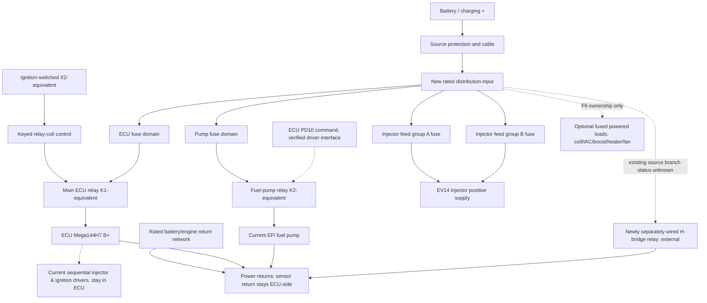

# Replacement relay/fuse-box functional architecture — v0.1

_2026-11-02 · REVIEW CONCEPT ONLY: **not a KiCad schematic, production wiring drawing or approved netlist**_

## Architectural question

What is the smallest reliable, serviceable set of relay and fuse functions required to replace **only the currently used** portion of the aftermarket MegaSquirt power board? The 2002 B&G PCB had main ECU power, pump, injectors, fast idle, signal pass-through, and PTC protection; the 2026 Mega144H7/EpicEFI car has different electronics and an independently powered DC idle H-bridge.

**Working proposal:** two primary relays (main ECU-related supply and ECU-controlled pump), physically separate protection of **ECU + pump + injector positive groups** as the four baseline fuse-function domains. This is a **functional starting point**, not confirmation of 2 relays/four fuse-holder positions in the final device. Include coil, PWM idle, boost, LC-1 or fan branches only after F6 confirms the power belongs to the old box or the owner deliberately consolidates it.

## Functional boundaries (no electrical pin numbers implied)

This chart is **topological only**. The *actual* safe choice of whether ECU/fuel-pump/injector feeds branch from battery-unswitched or main-relay-switched nodes, the location of fuses relative to relays, and whether they share the battery X1 trunk are **unresolved**. The chart deliberately avoids implying that PD10 itself can directly sink any arbitrarily selected relay-coil current.

## Two candidate physical implementations (no decision to manufacture)

| Concept | Benefit | Main risk / tradeoff | When it becomes suitable |
|---|---|---|---|
| **A: relay/fuse PCB as complete power carrier** | Compact, all fuse/relay sockets and labels integrated | Board copper, connectors, thermal margins and contact resistance must safely carry all real currents | Only after F7 load/thermal data establish valid PCB copper layers and high-current paths |
| **B: hybrid relay/fuse carrier with heavy-current external distribution** | Fuse/relay sockets can be serviceable while heavy current uses appropriate terminals/busbar, PCB restricted to control and any suitably rated distribution | More wiring/mechanical parts and potential contact points | Useful if measured pump/coil/fan currents or enclosure thermal conditions make PCB copper too demanding |

**Recommendation for design review:** Keep both options open through F7; prioritize low loss and serviceability over achieving a single-board aesthetic. Reusing old PCB high-current traces or CB2-type PTC devices without analysis would recreate historical failure risks. Avoid an MCU, CAN dependency or custom software for essential supply switching.

## Confirmed controls vs assumptions

| Interface | Confirmed current description | What must NOT be inferred |
|---|---|---|
| Existing X1 | Constant B+ behind upstream separate 30 A protection; estimated ~4 mm² cable | Available current headroom, fuse adequacy or max combined load |
| Existing X2 | Ignition-switched +12 V | Behavior during CRANK and coil-driver fuse logic |
| Existing X3 | Engine-ground reference | That all ECU/sensor/motor returns should use shared PCB copper |
| ECU PD10 | Current ECU fuel-pump relay output | Polarity, maximum coil current, flyback components, safe boot state |
| Existing B&G K1/CB2 | Historical source schematic K1 → CB2 → `12 RAW` | Fitted CB2 identity, actual current ECU path, need for new PTC |
| EV14 injectors | Four sequential injector low-side outputs | Historical 2-channel JP1 can be copied or grounded together |
| DC idle H-bridge | New wiring/relay installed and reported to improve operation | Exact source, relay contact/fuse and ground location; no reason to rewire or merge it |
| Factory Volvo LH | Current EpicEFI does not use OEM LH fuel relay/fuse harness | That old Volvo relay sockets belong in new box |

## Proposed naming policy for design discussion

Reference names describe **functions only**, not approved schematics or physical wire connections.

| Proposed logical name | Function |
|---|---|
| `VBAT_PROTECTED_IN` | Protected battery-fed input to replacement module |
| `IGN_RUN_START_SENSE` | Ignition logic/control reference |
| `ECU_PWR_SW` | Relay-switched ECU positive output |
| `ECU_PWR_RET` | ECU power return boundary, **not sensor ground** |
| `PUMP_PWR_SW` | ECU-authorized pump-positive output |
| `PUMP_RELAY_CMD` | ECU relay command interface from PD10 via validated driver/suppression |
| `INJ_BAT_A`, `INJ_BAT_B` | Injector positive feed groups, grouping TBD |
| `ACTUATOR_BAT_OPT` | Optional protected power output(s), count TBD |
| `CHASSIS_ENGINE_PWR_RET` | Defined high-current return network reference outside sensor returns |
| `SENSOR_GND_EXCLUDED` | No high-current load allowed |

## Required reviews before schematic work

1. Freeze included **load ownership** based on `docs/F6_REPLACEMENT_CIRCUIT_MATRIX.md` and confirm whether two essential relays plus injector/ECU/pump fuse functions covers all current box loads.
2. Determine actual ECU/ignition/pump driver behavior in **OFF/RUN/CRANK/STALL/ECU_RESET**, including the exact allowable prime behavior and how the relay drops out if PD10 is lost.
3. Evaluate whether main-relay source feeds injectors and pump and whether fused individual branches must be **before or after** contact, accounting for source fault, contact welding and source voltage drop. No unreviewed direct battery bypass of pump failsafe.
4. Assign branch current, relay making/continuous/breaking ratings, fuse curves, connector and wire sizes, and maximum allowed voltage/thermal drops from `docs/F7_ELECTRICAL_REQUIREMENTS_V0.md`.
5. Choose concept A or B after F7 load analysis; design for realistic enclosure, moisture, vibration and replaceable parts.
6. Map **every old physically connected wire** to a replacement connector, preserve appropriate ECU signal references, and plan a reversible migration/bench harness where possible.
7. Only after design review (F8) create KiCad schematic with explicit source/net traces and automated ERC/DRC, followed by independent review and bench fault testing. Current KiCad 9 capabilities are supported; KiCad 10 and design editing tool claims require later verification.

**Decision status:** Functional architecture v0.1 established, **not frozen**. F6/F7/F8 remain OPEN, no board layout, component value or manufacturing release approved.
